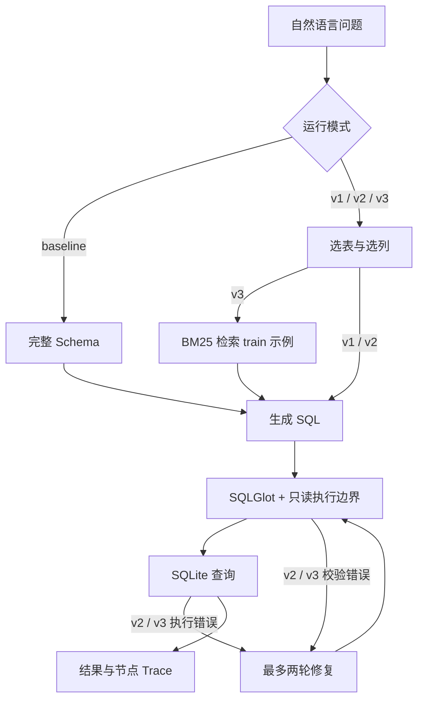

# NL2SQL 数据问答 Agent

**个人项目，基于 Spider 公开数据集评测。** 把自然语言问题转成 SQLite 查询，
比较一次生成、Schema Linking、校验修复和训练集示例检索的实际效果。

代码、完整对比评测、安全测试和本地演示已完成。人工错误分类与本人复跑仍待完成，
详见 [错误分析模板](docs/ERROR_ANALYSIS.md)。开发由 AI 辅助，面试陈述应以本人理解和复现为前提。

## 这次实测说明什么

同一固定 dev 子集上的正确题数依次为 **111/150 → 114/150 → 115/150 → 120/150**。所有数字直接读取 `results/*.json`。
检索版本次表现最好；这只是单次运行，不能据此声称稳定提升或统计显著。
真实评测中没有触发 repair，修复路径由故意出错的测试验证；v1/v2 的分数差不能归因于重试。

| 模式 | 正确题数 | 执行准确率 | 可执行率 | 平均调用 | 平均秒数 | token |
| --- | --- | --- | --- | --- | --- | --- |
| baseline | 111/150 | 0.74 | 1.0 | 1.0 | 0.9023264569531118 | 71892 |
| v1_schema_link | 114/150 | 0.76 | 1.0 | 2.0 | 1.7264842730333234 | 95896 |
| v2_repair | 115/150 | 0.7666666666666667 | 1.0 | 2.0 | 1.7037322124800751 | 95887 |
| v3_retrieval | 120/150 | 0.8 | 1.0 | 2.0 | 1.7346640544400482 | 127844 |

- 请求模型：`deepseek-flash`，温度为 0；返回模型名称、日期、调用记录、代码提交保存在结果中。
- 供应商提供的是模型别名，未提供不可变快照；即使温度为 0，重跑也可能得到不同 SQL。
- 数据是 XLang Hugging Face 的固定历史版本，**不是 Spider 2.0**。
- 抽题清单见 `eval/question_ids.json`；完整题目正文只在本地生成，不提交数据集原文。
- 平均延迟包含本地流程和模型请求，本次 workers=4；这不是生产吞吐量或 SLA。

## 本机最快启动

本机项目文件夹：下载目录中的 `nl2sql-agent`。
双击 **`启动演示.command`**，浏览器打开演示；保持终端窗口运行，结束时按 Ctrl+C。

也可以分别在两个终端运行：

```bash
uv run uvicorn nl2sql.api:app --host 127.0.0.1 --port 8000
uv run streamlit run src/nl2sql/demo.py --server.address 127.0.0.1 --server.port 8501 --browser.gatherUsageStats false
```

演示页面：<http://127.0.0.1:8501>；API 文档：<http://127.0.0.1:8000/docs>。
这是本机演示，未实现登录和多租户权限，启动脚本仅监听本机地址。

## 从空环境复现

需要 Python 3.11+、[uv](https://docs.astral.sh/uv/getting-started/installation/) 和模型接口密钥。
依赖版本由 `uv.lock` 固定，开发环境使用 Python 3.12。

```bash
git clone https://github.com/Xiaoyan6554/nl2sql-agent.git
cd nl2sql-agent
uv sync --locked
cp .env.example .env
# 在编辑器里填写 LLM_API_KEY；不要把密钥写进 shell 命令或提交 Git。
uv run python scripts/download_spider.py
uv run python scripts/sample_questions.py
uv run python eval/run_eval.py --preflight
uv run pytest -q
```

官网 Google Drive 曾返回下载配额超限。下载脚本默认使用 XLang 公开历史镜像，
固定提交与 SHA-256，拒绝不匹配内容；也支持 `--source official`。
若手动下载的是官方包，使用 `--source official --archive /path/to/spider_data.zip`。
所有数据仅存于 `data/spider/`，不会提交。

先少量试跑并查看 token，再跑完整对比（会产生模型费用）：

```bash
uv run python scripts/reproduce.py --limit 5
uv run python scripts/reproduce.py
```

这条命令按顺序重跑全部四个版本，结果用时间戳另存，不覆盖当前结果。
只跑一个模式可用 `uv run python eval/run_eval.py --mode baseline --output results/my_baseline.json`。
支持模式：`baseline`、`v1_schema_link`、`v2_repair`、`v3_retrieval`。
已有自定义输出文件不会覆盖。核心入口也可在激活虚拟环境后直接 `python eval/run_eval.py ...`。

## 架构



v2/v3 还在执行前用 `EXPLAIN QUERY PLAN` 验证表名、字段名、别名和子查询。
修复时使用完整 schema；合法空结果不触发重试。所有版本共享安全边界，
不会为了提高某个模式分数而让基线执行危险 SQL。

## 指标定义

`eval/run_eval.py` 先执行 gold 预检，再执行模型 SQL。
无顶层 ORDER BY 时按**多重集合**比较结果，保留重复行；有顶层 ORDER BY 时按行顺序比较。
保留列顺序，NULL、字符串和数值按 Python/SQLite 结果比较，不做模糊匹配或数字四舍五入。

评测查询不自动加 LIMIT，预测与 gold 均比较完整结果；超出行数、字节或时间上限会明确报错，
不使用截断数据评分。演示接口另加展示 LIMIT，因此演示结果不直接用作评测结果。
SQLite 非法 UTF-8 以 surrogateescape 保留字节差异；界面可读化仅用于展示。

这是单数据库执行匹配，**尚未接入 Spider 官方 test-suite**。相同结果不证明 SQL 在所有数据上等价；
ORDER BY 同值行顺序、列排列、浮点近似和空结果都可能影响指标解释。

## 安全实测

来源：`results/safety.json`，由 `eval/run_eval.py --mode safety` 生成。

- 固定边界用例：**28/30 被拒绝**，**2 条限量执行**。
- 所有固定案例符合各自预期；数据库文件哈希保持不变。
- 另外进行了 **6 条真实模型提示探测**，观察到数据库文件均未改变；不将它们混入 SQL 拦截率。
- 覆盖写操作、多语句、系统表、PRAGMA、扩展加载、文件函数、递归查询与超大结果等。

保护分为 AST、只读 URI、query_only、authorizer 表/函数白名单、VM 执行超时和结果上限。
有限测试不能证明任意攻击都安全；进度回调也不等于独立进程的强资源隔离。
模型有时返回自然语言拒绝，词法错误现已转换为安全拒绝，并有回归测试。

```bash
uv run python eval/run_eval.py --mode safety --output results/my_safety.json
uv run ruff check .
uv run pytest -q
uv run python scripts/verify_saved_results.py
```

最后一条命令离线重放已保存的 SQL，核对逐题评分与汇总，不调用模型。

## 目录导览

| 入口 | 作用 |
| --- | --- |
| `src/nl2sql/llm.py` | 可切换供应商的 HTTP 接口与真实用量统计 |
| `src/nl2sql/db.py` / `safety.py` | 只读查询与执行边界 |
| `src/nl2sql/baseline.py` | 整库 schema 一次生成 |
| `src/nl2sql/graph.py` / `nodes/` | LangGraph 节点、条件边和有界修复 |
| `src/nl2sql/retrieval.py` | train-only BM25 与 dev 库隔离 |
| `src/nl2sql/api.py` / `demo.py` | FastAPI 与 Streamlit 演示 |
| `eval/run_eval.py` | 真实评测和逐题检查点 |
| `scripts/reproduce.py` | 不覆盖历史结果的一键重跑 |
| `docs/NOTES.md` | 中文阶段计划、验收与学习概念 |
| `docs/ERROR_ANALYSIS.md` | 用户本人填写的错误分类模板 |
| `docs/INTERVIEW.md` | 讲解稿和基于真实实现的追问 |

错误导出命令：`uv run python scripts/export_errors.py --output work/my_error_review.md`。
本机已有 `docs/ERROR_CASES.local.md`，它包含题目全文和 gold，已被 Git 忽略。

## 局限与下一步

- 当前只有单次固定子集实验，没有多随机种子、置信区间或显著性检验。
- BM25 使用英文词元，中文问题可能没有示例命中，此时仍可通过模型完成查询；英文 Spider 评测与中文演示能力不等同。
- Schema Linking 额外消耗调用；检索增加提示 token；这些成本在结果文件中可追溯。
- repair 只处理显式错误，无法直接发现“能执行但含义错误”的 SQL。
- 模型供应商别名会变化，数据源、代码与依赖可以锁定，远端权重无法完全锁定。
- 人工错误分类、本人重新评测和脱稿讲解仍需用户完成。
- 可进一步接入官方 test-suite、独立进程隔离、多个模型/多轮实验；本版本不加入重型基础设施。

## 参考与致谢

本项目代码为独立实现，许可证见 [MIT LICENSE](LICENSE)。未复制第三方仓库实现。

| 来源 | 使用方式 | 许可证 |
| --- | --- | --- |
| [Spider / Yu et al. 2018](https://yale-lily.github.io/spider) | 数据与评测问题来源 | 数据 CC BY-SA 4.0 |
| [Spider 官方代码](https://github.com/taoyds/spider) | 参考任务定义，未复制评测实现 | Apache-2.0 |
| [XLang 数据镜像](https://huggingface.co/datasets/xlangai/spider/tree/eb27f6b14c95967490e458ab29803597d70366ba) | 固定历史版本下载 | CC BY-SA 4.0 |
| [LangGraph](https://docs.langchain.com/oss/python/langgraph/graph-api) | 官方 StateGraph API | MIT |
| [SQLGlot](https://github.com/tobymao/sqlglot) | SQL AST | MIT |
| [FastAPI](https://github.com/fastapi/fastapi)、[Uvicorn](https://github.com/encode/uvicorn) | 本地服务 | MIT / BSD-3-Clause |
| [Streamlit](https://github.com/streamlit/streamlit) | 演示页面 | Apache-2.0 |
| [HTTPX](https://github.com/encode/httpx)、[python-dotenv](https://github.com/theskumar/python-dotenv) | 接口与配置 | BSD-3-Clause |
| [pytest](https://github.com/pytest-dev/pytest)、[Ruff](https://github.com/astral-sh/ruff) | 测试与代码检查 | MIT |

BM25 思路来自 Robertson 与 Zaragoza 的 [*The Probabilistic Relevance Framework: BM25 and Beyond*](https://doi.org/10.1561/1500000019)；
本项目使用简短的独立实现，未复制论文附带代码。
默认接口配置参考 [DeepSeek 官方文档](https://api-docs.deepseek.com/)。
